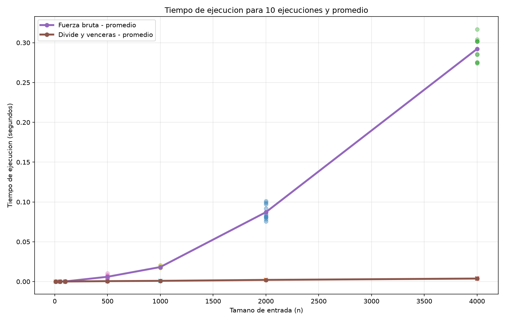

# Laboratorio evaluativo 02 - Dividir y vencer

## Autores

- Jhon Fernando Sánchez Álvarez

## Tecnologías utilizadas

- Python 3.13
- Git y GitHub
- `time.perf_counter()` para la medición de tiempos
- Matplotlib para la generación de gráficas

## Requisitos

- Python 3.13
- Git
- Matplotlib

## Ejecución

### 1. Activar el entorno virtual

Desde la carpeta del repositorio:

**Windows PowerShell:**

```powershell
.\.venv\Scripts\Activate.ps1
```

**Git Bash:**

```bash
source .venv/Scripts/activate
```

### 2. Instalar las dependencias

```bash
pip install -r requirements.txt
```

### 3. Ejecutar las pruebas

```bash
cd laboratorios\lab2-divide-y-vencer
```

```bash
python pruebas.py
```

Este script ejecuta las pruebas de los algoritmos de **fuerza bruta** y **divide y vencerás**, incluyendo casos pequeños, valores negativos, valores positivos, un caso que cruza el punto medio y diferentes listas aleatorias.

Si todas las pruebas son correctas, se mostrará:

```text
Todas las pruebas fueron superadas correctamente.
```

### 4. Ejecutar las mediciones

```bash
python medicion.py
```

Este script ejecuta ambos algoritmos sobre diferentes tamaños de entrada, realiza **10 ejecuciones por cada tamaño**, calcula el promedio de los tiempos y verifica que ambos algoritmos obtengan la misma suma máxima.

También genera la gráfica con las mediciones y los promedios.

La gráfica se guarda automáticamente en:

```text
graficas/tiempo_vs_n.png
```

### 5. Desactivar el entorno virtual

```bash
cd ../..
```

```bash
deactivate
```

# Parte 1 — Verificación de las soluciones

Codificación de los algoritmos para subarreglos:

[código de subarreglos](subarreglo.py)

Las pruebas utilizadas para probar los algoritmos:

[código de pruebas](pruebas.py)

Se verificaron las dos soluciones implementadas para encontrar el subarreglo de suma máxima: **fuerza bruta** y **divide y vencerás**.

Las pruebas incluyeron diferentes situaciones para comprobar que ambas soluciones obtienen la misma suma máxima:

- La serie de 8 días planteada en el problema: `[-3, 5, -2, 8, -6, 3, 9, -4]`, cuyo resultado esperado es `17`.
- Una serie con un solo elemento.
- Una serie donde todos los valores son negativos.
- Una serie donde todos los valores son positivos.
- Una serie en la que el subarreglo óptimo cruza el punto medio, para verificar específicamente la función utilizada por divide y vencerás.
- **30 listas generadas aleatoriamente**, utilizando una semilla fija, para comparar los resultados obtenidos por ambos algoritmos.

Las pruebas se realizaron mediante instrucciones `assert`, comparando principalmente la suma máxima obtenida por cada solución. De esta manera se comprobó que ambas implementaciones producen el mismo resultado para los casos evaluados.

Para reproducir las pruebas:

```bash
python pruebas.py
```

Si todas las pruebas son correctas, se muestra el mensaje:

```text
Todas las pruebas fueron superadas correctamente.
```

# Parte 2 — Medición y gráfica

Codificación de las mediciones:

[código de mediciones](medicion.py)

Para comparar el comportamiento de los algoritmos se utilizaron los siguientes tamaños de entrada:

`10, 50, 100, 500, 1000, 2000 y 4000`

Para cada tamaño de entrada, creamos un conjunto de números enteros aleatorios, con valores entre `-100` y `100`. Usamos una semilla fija (`42`) para asegurarnos de que la misma lista se aplicara a ambos algoritmos. Esto permitió una comparación justa, ya que las condiciones eran idénticas.

Repetimos cada prueba **10 veces**. Después, calculamos el tiempo promedio de todas esas ejecuciones. Es importante destacar que solo medimos el tiempo que tardaba el algoritmo en ejecutarse, sin contar el tiempo que llevaba crear los datos.

Además, en cada tamaño se verificó que ambos algoritmos obtuvieran la misma suma máxima antes de registrar los resultados.

La gráfica resultante muestra los tiempos de las ejecuciones y el promedio para cada algoritmo:



Los resultados indican que, para entradas pequeñas, los tiempos de los algoritmos son muy bajos y las diferencias resultan difíciles de distinguir en la gráfica. La fuerza bruta puede beneficiarse de no necesitar llamadas recursivas, mientras que divide y vencerás debe dividir el problema y combinar los resultados.

No obstante, conforme aumenta el tamaño de la entrada, la diferencia se vuelve mucho más notoria. La curva de fuerza bruta crece más rápidamente que la de divide y vencerás.

Por ejemplo, para `n = 4000`, la fuerza bruta obtuvo un tiempo promedio aproximado de **0.292 s**, mientras que divide y vencerás obtuvo aproximadamente **0.0038 s**. Según estas aproximaciones, divide y vencerás tardó alrededor de 77 veces menos.

Los tiempos de cada ejecución se registraron para obtener el promedio mostrado en la gráfica. Los valores descritos en este informe son aproximaciones visuales de la gráfica y deben contrastarse con los promedios originales del programa para obtener cifras exactas.

# Parte 3 — Análisis de los resultados

## 3.1. Recurrencia y análisis de complejidad

### Divide y vencerás

El algoritmo divide la lista en dos subproblemas de tamaño aproximadamente $n/2$, resuelve cada uno de forma recursiva y después combina los resultados para encontrar el subarreglo de suma máxima.

La recurrencia es:

$$
T(n)=2T(n/2)+\Theta(n)
$$

Cada término tiene una justificación:

- **$2T(n/2)$:** se realizan dos llamadas recursivas, una para la mitad izquierda y otra para la mitad derecha de la lista.
- **$n/2$:** cada subproblema contiene aproximadamente la mitad de los elementos originales, porque el algoritmo calcula el punto medio y divide la lista en dos partes.
- **$\Theta(n)$:** corresponde a encontrar el mejor subarreglo que cruza el punto medio. La función `suma_cruzada` recorre la mitad izquierda hacia atrás y la mitad derecha hacia adelante. En conjunto, visita como máximo $n$ elementos, por lo que el costo de combinar los resultados es lineal.

Para resolver la recurrencia mediante el método maestro, se compara con la forma general:

$$
T(n)=aT(n/b)+f(n)
$$

En este caso:

$$
a=2,\qquad b=2,\qquad f(n)=\Theta(n)
$$

Primero, se calcula el término de comparación:

$$
n^{\log_b a}=n^{\log_2 2}=n^1=n
$$

Como $f(n)=\Theta(n)$, se cumple que:

$$
f(n)=\Theta\left(n^{\log_b a}\right)
$$

Por lo tanto, corresponde al **caso 2 del método maestro**, en el que el costo adicional tiene el mismo orden de crecimiento que el término de comparación. Se aplica este caso porque $f(n)$ es asintóticamente del mismo orden que $n^{\log_b a}$.

El resultado es:

$$
T(n)=\Theta(n\log n)
$$

En conclusión, divide y vencerás tiene complejidad temporal $\Theta(n\log n)$, ya que divide el problema en dos partes, resuelve ambas recursivamente y realiza un trabajo lineal para combinar sus resultados.

## 3.2. Lo medido contra lo esperado

Al comparar los tamaños $n=500$ y $n=1000$, el tiempo de ejecución de fuerza bruta pasó de aproximadamente $0.006$ a $0.018$ segundos, lo que representa un aumento cercano a **3 veces**. Teóricamente, al duplicar el tamaño de entrada, para una complejidad cuadrática se esperaría un crecimiento aproximado de:

$$
\frac{T(1000)}{T(500)}\approx 2^2=4
$$

En divide y vencerás, tomando como referencia las aproximaciones visuales de $0.0003$ segundos para $n=500$ y $0.00074$ segundos para $n=1000$, el tiempo aumentó aproximadamente **2.47 veces**:

$$
\frac{0.00074}{0.0003}\approx 2.47
$$

Para una complejidad de $O(n\log n)$, el crecimiento teórico esperado sería:

$$
\frac{1000\log_2(1000)}
{500\log_2(500)}
\approx 2.20
$$

Los resultados aproximados son compatibles con la tendencia teórica, aunque no coinciden exactamente. Esta diferencia puede deberse a los costos fijos de ejecución, las llamadas recursivas y la precisión de las mediciones.

Como comparación adicional, se analizaron los tiempos promedio para $n=2000$ y $n=4000$, obtenidos mediante `medicion.py`. En fuerza bruta, el tiempo pasó de $0.083150$ a $0.314219$ segundos, lo que representa un crecimiento aproximado de **3.78 veces**:

$$
\frac{0.314219}{0.083150}\approx 3.78
$$

Este resultado se aproxima al crecimiento teórico de 4 veces esperado para una complejidad cuadrática, dado que el tamaño de entrada se duplicó.

Por su parte, divide y vencerás pasó de $0.002085$ a $0.004455$ segundos, lo que representa un crecimiento aproximado de **2.14 veces**:

$$
\frac{0.004455}{0.002085}\approx 2.14
$$

Este resultado es cercano al factor teórico de aproximadamente $2.20$ esperado para una complejidad de $O(n\log n)$:

$$
\frac{4000\log_2(4000)}
{2000\log_2(2000)}
\approx 2.20
$$

En conclusión, la comparación muestra que fuerza bruta presenta un crecimiento cercano al cuadrático, mientras que divide y vencerás exhibe un crecimiento cercano a $n\log n$. Las diferencias entre los valores medidos y los teóricos pueden atribuirse a las variaciones propias de las mediciones experimentales. La tendencia observada respalda el análisis de complejidad de ambos algoritmos.


## 3.3. ¿Qué pasa con los tamaños pequeños?

Con $n=10$, ambos algoritmos presentan tiempos muy bajos y la gráfica no permite distinguir con precisión cuál es más rápido. En listas pequeñas, fuerza bruta puede tener una ventaja porque evita las llamadas recursivas y el trabajo adicional de dividir y combinar los resultados.

Para $n=500$, $n=1000$, $n=2000$ y $n=4000$, la diferencia entre las curvas es mucho más visible. En particular, para $n=4000$, fuerza bruta tardó aproximadamente $0.292$ segundos, mientras que divide y vencerás tardó aproximadamente $0.0038$ segundos.

Esto demuestra que, para el problema evaluado, divide y vencerás ofrece una ventaja importante cuando aumenta la cantidad de datos.

## 3.4. ¿Cuándo conviene dividir?

Dividir un problema no siempre mejora su rendimiento. Por ejemplo, para encontrar el valor máximo de una lista basta con recorrerla una sola vez y guardar el mayor elemento encontrado. La recurrencia de este método es:

$$
T(n)=T(n-1)+\Theta(1)
$$

Su complejidad temporal es:

$$
T(n)=\Theta(n)
$$

Si se divide la lista en dos mitades, se encuentra el máximo de cada una de forma recursiva y luego se comparan ambos resultados, la recurrencia sería:

$$
T(n)=2T(n/2)+\Theta(1)
$$

El costo de combinar es $\Theta(1)$ porque solo se necesita una comparación entre los dos máximos obtenidos. Aplicando el método maestro, con $a=2$, $b=2$ y $f(n)=\Theta(1)$, se obtiene:

$$
n^{\log_b a}=n^{\log_2 2}=n
$$

Como $f(n)=\Theta(1)=O(n^{1-\varepsilon})$ para $\varepsilon=1$, corresponde al caso 1 del método maestro. Por tanto, la complejidad del algoritmo también es:

$$
T(n)=\Theta(n)
$$

En conclusión, dividir la lista no mejora la complejidad asintótica para encontrar el valor máximo, ya que ambos métodos tienen un costo lineal. Sin embargo, el enfoque recursivo agrega trabajo de división y llamadas recursivas, por lo que un recorrido lineal directo resulta más sencillo y conveniente.

## 3.5. Recomendación para la cooperativa

Para encontrar el subarreglo de suma máxima, recomendaría divide y vencerás frente a fuerza bruta, porque las mediciones muestran que funciona mejor cuando aumenta la cantidad de datos.

Tomando como referencia el tiempo registrado para $n=4000$ y extrapolando según la complejidad de cada algoritmo, para un millón de registros se estiman los siguientes tiempos.

Para fuerza bruta:

$$
0.314219\left(\frac{1\,000\,000}{4\,000}\right)^2
\approx 19\,639\text{ s}
$$

Esto equivale aproximadamente a $5.45$ horas.

Para divide y vencerás:

$$
0.004455
\left(
\frac{1\,000\,000\log_2(1\,000\,000)}
{4\,000\log_2(4\,000)}
\right)
\approx 1.85\text{ s}
$$

| Algoritmo | Complejidad | Tiempo estimado |
|---|---|---:|
| Fuerza bruta | $\Theta(n^2)$ | 5.45 horas |
| Divide y vencerás | $\Theta(n\log n)$ | 1.85 segundos |

Estos valores son estimaciones matemáticas, no mediciones reales para un millón de registros. El tiempo efectivo puede variar según el computador y las condiciones de ejecución.

En conclusión, divide y vencerás es la alternativa más conveniente entre las dos evaluadas, especialmente si la cooperativa necesita analizar grandes cantidades de información.

---

## Autores

- Jhon Fernando Sánchez Álvarez
--- 
