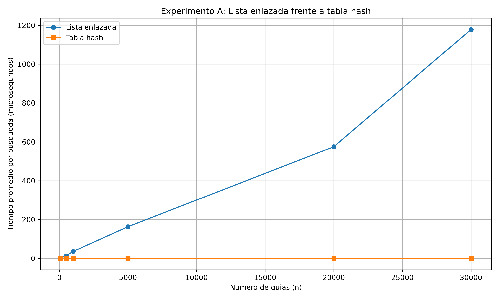
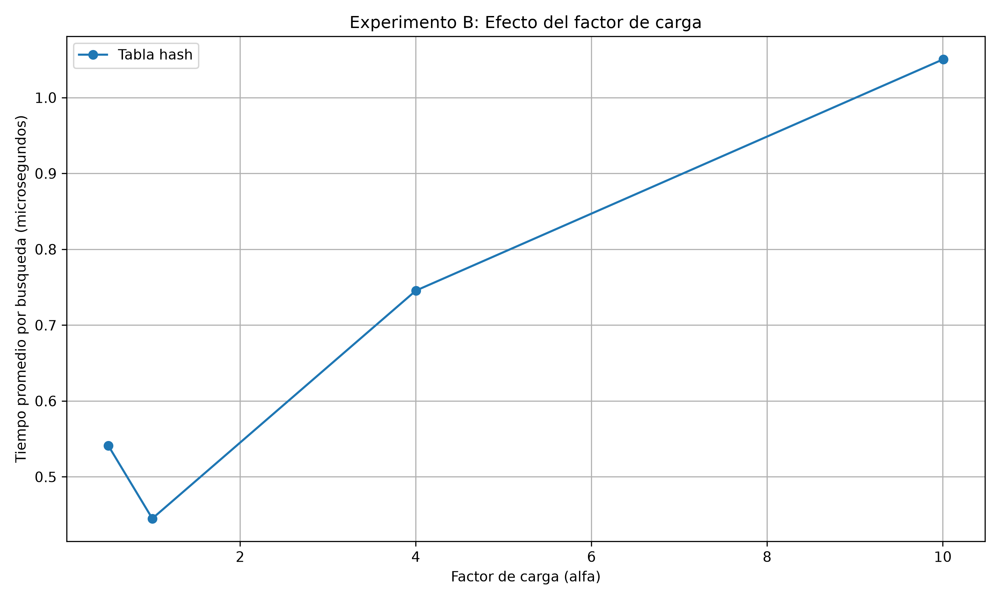

# Laboratorio evaluativo 03 - Estructuras de datos

## Autores

- Jhon Fernando Sánchez Álvarez

## Tecnologías utilizadas

- Python 3.13
- Git y GitHub
- `time.perf_counter()` para la medición de tiempos
- Matplotlib para la generación de gráficas

## Requisitos

- Python 3.13
- Git
- Matplotlib

## Ejecución

### 1. Activar el entorno virtual

Desde la carpeta del repositorio:

**Windows PowerShell:**

```powershell
.\.venv\Scripts\Activate.ps1
```

**Git Bash:**

```bash
source .venv/Scripts/activate
```

### 2. Instalar las dependencias

```bash
pip install -r requirements.txt
```

### 3. Ejecutar las pruebas

```bash
cd laboratorios\lab3-estructuras-datos
```

```bash
python pruebas.py
```

Este comando ejecuta las pruebas de funcionamiento de las listas enlazadas y las tablas hash.

### 4. Ejecutar las mediciones

```powershell
python medicion.py
```

Este comando ejecuta los experimentos de rendimiento y genera las dos gráficas dentro de la carpeta `graficas`.

---

## Parte 1 — Verificación de las estructuras

**Archivos de código:** [estructuras.py](estructuras.py) | [pruebas.py](pruebas.py)

Para verificar el funcionamiento de las estructuras implementadas se realizaron pruebas automatizadas mediante instrucciones `assert`, comprobando que los resultados obtenidos fueran iguales a los esperados.

Se cubrieron los siguientes casos:

- **Inserción y búsqueda exitosa:** comprobar que una guía almacenada devuelve su estado correspondiente.
- **Búsqueda fallida:** verificar que una guía inexistente devuelve `None`.
- **Colisiones:** comprobar que varias guías que generan la misma posición pueden almacenarse y recuperarse correctamente.
- **Factor de carga:** verificar que el cálculo de la relación entre elementos y casillas sea correcto.
- **Diferentes cantidades de datos:** comprobar el funcionamiento de las estructuras con varias colecciones de guías.

Con estas pruebas se verificó que tanto la lista enlazada como la tabla hash almacenan y recuperan correctamente la información.

## Parte 2 — Experimentos y mediciones

**Archivo de código:** [medicion.py](medicion.py)

Se realizaron dos experimentos utilizando datos generados aleatoriamente y una semilla fija para facilitar la repetición de las pruebas.

Para medir el rendimiento se utilizó `time.perf_counter()`, calculando el tiempo promedio por búsqueda. Cada configuración realizó 200 búsquedas de guías inexistentes. Los resultados se expresaron en microsegundos por búsqueda.

### Experimento A: lista enlazada frente a tabla hash

Se aumentó la cantidad de guías y se mantuvo un factor de carga cercano a 2.

| Guías (n) | Casillas (m) | Factor de carga | Lista enlazada (µs) | Tabla hash (µs) |
|---:|---:|---:|---:|---:|
| 100 | 47 | 2.13 | 2.41 | 0.16 |
| 500 | 251 | 1.99 | 12.93 | 0.22 |
| 1.000 | 499 | 2.00 | 36.02 | 0.31 |
| 5.000 | 2.503 | 2.00 | 163.43 | 0.48 |
| 20.000 | 10.007 | 2.00 | 575.03 | 0.79 |
| 30.000 | 15.013 | 2.00 | 1.178,23 | 0.45 |



### Experimento B: efecto del factor de carga

Se mantuvieron 20.000 guías y se modificó la cantidad de casillas de la tabla.

| Factor de carga (α) | Casillas (m) | Tiempo promedio (µs) |
|---:|---:|---:|
| 0.4999 | 40.009 | 0.54 |
| 1.0002 | 19.997 | 0.45 |
| 4.0008 | 4.999 | 0.75 |
| 10.0050 | 1.999 | 1.05 |



## Parte 3 — Análisis

### 1. Costo teórico

Buscar algo que no existe en una lista enlazada toma tiempo Θ(n), ya que es necesario revisar cada nodo para confirmar que no está allí. En una tabla hash con encadenamiento, la búsqueda usualmente cuesta Θ(1 + α), donde α = n/m es la proporción de elementos por casilla. Esto asume que la función hash reparte los elementos de forma bastante equitativa entre las casillas. Si todos los elementos terminaran en la misma casilla, la búsqueda empeoraría hasta Θ(n), porque tendríamos que revisar toda la lista de esa única casilla.

### 2. Lo medido contra lo esperado

En el primer gráfico, al usar 5,000 y luego 20,000 elementos, el número de operaciones se multiplicó por cuatro. La lista enlazada, que tardaba entre 163,43 y 575,03 microsegundos, tardó aproximadamente 3,52 veces más. Esto encaja con un crecimiento lineal (Θ(n)), aunque no a la perfección debido a pequeñas fallas en las mediciones.

Por otro lado, la tabla hash pasó de 0,48 a 0,79 microsegundos, lo que significa que aumentó 1,65 veces. Aunque no fue totalmente constante, sus tiempos fueron considerablemente menores y no se observó el incremento paulatino de la lista.

En la segunda ilustración, al cambiar el factor de carga de casi 0,5 a 10, el tiempo de ejecución fue de 0,54 a 1,05 microsegundos. La tendencia general es ascendente y concuerda con lo esperado para Θ(1 + α), aunque se aprecia una ligera variación en los primeros datos.

### 3. Explique las colisiones

Una colisión ocurre cuando dos guías diferentes generan la misma posición en la tabla. Puede suceder incluso cuando hay más casillas que guías, porque distintas claves pueden producir el mismo resultado de la función hash.

Con m = 7:

- 10 % 7 = 3
- 24 % 7 = 3
- 17 % 7 = 3

Las tres guías colisionan en la casilla 3.

El **encadenamiento** almacena los elementos que colisionan en una lista enlazada. Su ventaja es que permite guardar varios elementos en una misma casilla; su costo es recorrer la lista cuando hay varias colisiones.

El **direccionamiento abierto** busca otra casilla disponible mediante una secuencia de exploración. Su ventaja es que no necesita listas adicionales; su costo es que puede requerir varias exploraciones y presentar agrupamiento de elementos cuando la tabla se llena.

### 4. Tabla hash o árbol de búsqueda

Una tabla hash no sirve para buscar datos en un intervalo porque no guarda los elementos en orden. Para encontrar todos los elementos entre X e Y, habría que mirar en muchos sitios.

Un árbol de búsqueda binario sí organiza las claves y permite buscar intervalos bajando por las ramas correctas. En un árbol balanceado, buscar en un intervalo cuesta O(log n + k), donde k es el número de resultados.

Si los 400.000 elementos llegan ya ordenados y se meten uno a uno en un árbol binario normal, este podría convertirse en algo parecido a una lista. Tendría casi 400.000 niveles y una búsqueda podría requerir unas 400.000 comparaciones.

Por otro lado, un árbol balanceado tendría una altura de aproximadamente:

$$
\log_2(400000) \approx 18.61
$$

Es decir, unos 19 niveles, reduciendo considerablemente las comparaciones.

### 5. Concepto para la jefa de operaciones

Recomendaría combinar ambas estructuras: una tabla hash para las búsquedas puntuales por número de guía y un árbol binario de búsqueda equilibrado para las consultas por rangos.

Para estimar el tiempo con 5.000.000 de envíos, la lista enlazada presenta un comportamiento aproximadamente lineal. Tomando como referencia los 30.000 elementos medidos, cuyo tiempo fue de 1.178,23 µs, se obtiene la siguiente estimación:

$$
T( n ) \approx 0.03927 \times n \quad \text{microsegundos}
$$

Por tanto:

$$
T(5000000) \approx 196371.67\ \mu s
$$

Esto equivale aproximadamente a **196,37 milisegundos por búsqueda**.

Para la tabla hash, suponiendo que se conserva un factor de carga cercano a 2, con aproximadamente 2.500.000 casillas, el tiempo esperado se mantiene aproximadamente constante respecto a la cantidad total de elementos. Tomando como referencia las mediciones del experimento A, se estima un tiempo cercano a **0,5–0,8 microsegundos por búsqueda**.

Estos valores son estimaciones y no mediciones directas con cinco millones de envíos. El resultado real depende de la distribución de las guías, las colisiones y las condiciones del equipo.

## Autores

- Jhon Fernando Sánchez Álvarez
--- 